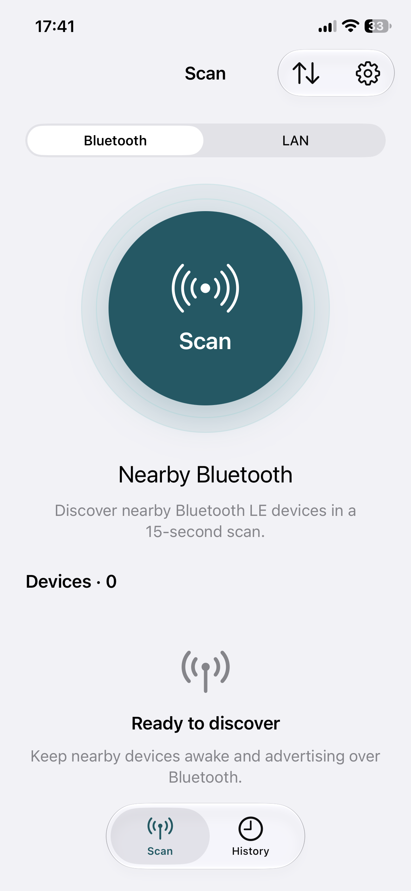
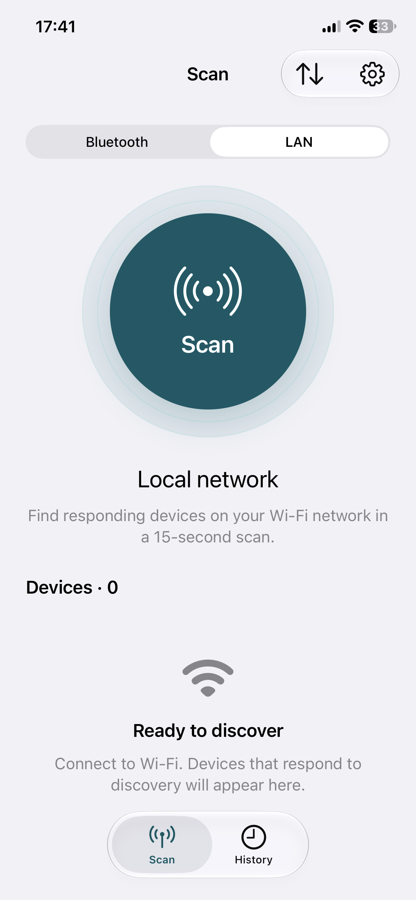
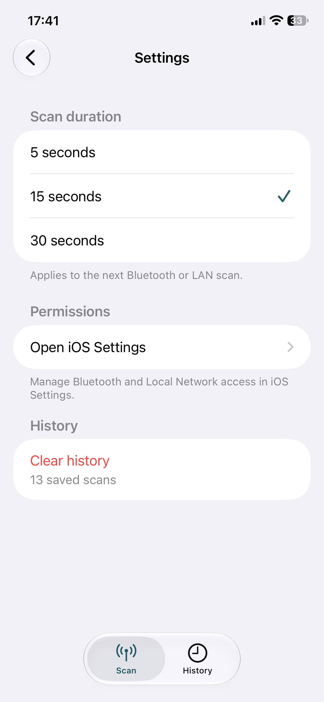
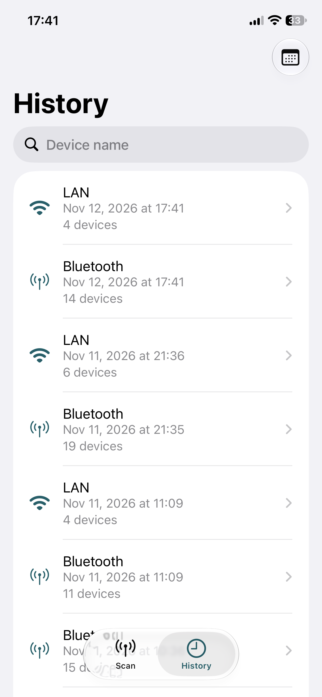
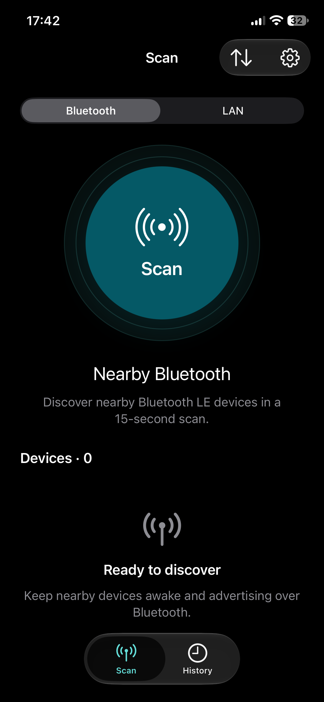
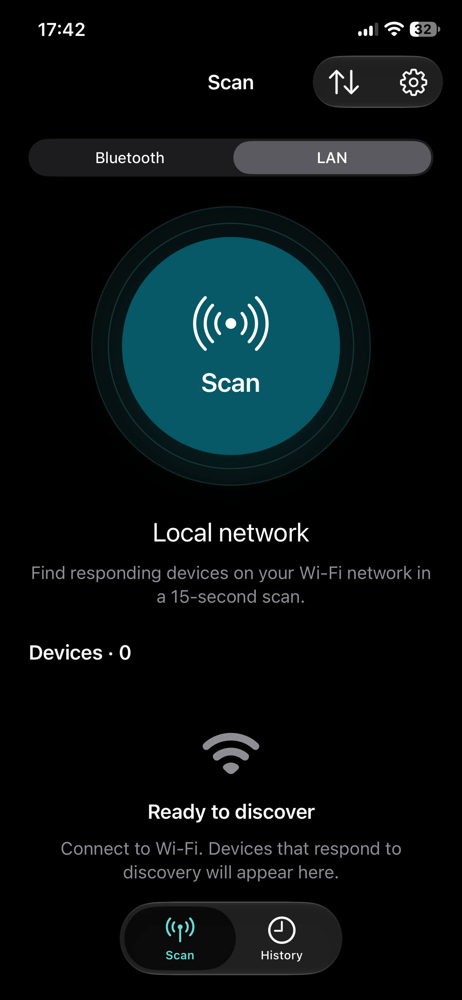
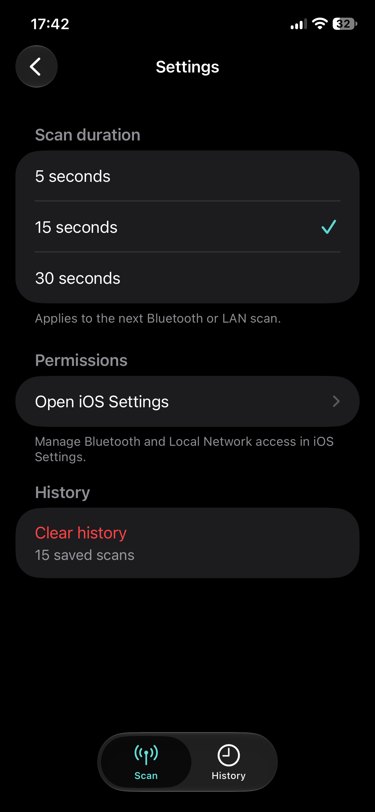
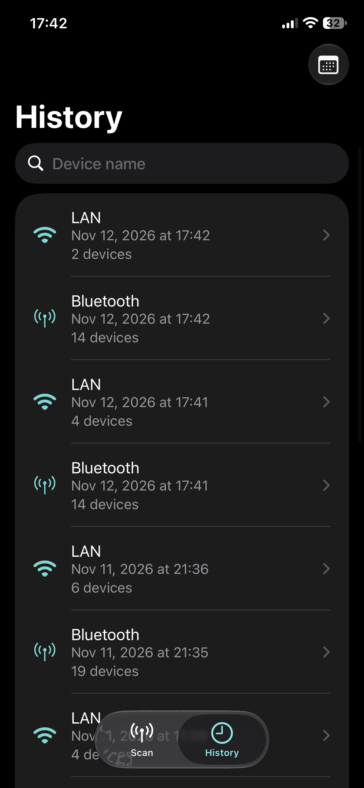
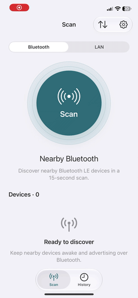

# BluetoothScan

## Описание приложения

BluetoothScan — приложение для iPhone, которое обнаруживает Bluetooth Low Energy устройства поблизости и устройства, отвечающие на запросы в локальной сети Wi-Fi. Результаты сохраняются на устройстве. К ним можно вернуться во вкладке History.

## Скриншоты и демо-видео

### Скриншоты

#### Светлая тема

    
    
    
    

#### Тёмная тема

    
    
    
    

### Демо-видео

## Технологический стек

- Swift и UIKit — интерфейс, таблицы и навигация.
- CoreBluetooth — поиск Bluetooth Low Energy устройств.
- MMLANScan и Network — поиск в локальной сети и запрос доступа к ней.
- Core Data — хранение сеансов и фильтрация истории.
- Lottie — анимация радара во время поиска.
- MVVM — представления, модели представлений и отдельные сервисы сканирования.
- Минимальная версия системы — iOS 15.

## Функциональность

### Сканирование

Во вкладке Scan можно выбрать Bluetooth или LAN и запустить поиск центральной кнопкой. Во время поиска отображаются анимация радара, прогресс и количество найденных устройств. Поиск можно остановить кнопкой Stop. Сканирование ограничено 15 секундами после начала поиска.

Приложение запрашивает доступ к Bluetooth или локальной сети при запуске соответствующего сканирования. После завершения показывается количество найденных устройств. При ошибке приложение сообщает причину и предлагает открыть настройки, если доступ запрещён.

### Список и детали устройств

Результаты появляются в таблице по мере обнаружения. Нажатие на строку открывает экран устройства.

- **Bluetooth:** имя при наличии, UUID, уровень сигнала RSSI и состояние подключения.
- **LAN:** IP-адрес, имя при наличии и поле MAC-адреса. В текущей реализации MAC-адрес недоступен.

LAN-сканирование показывает устройства, ответившие на запросы в текущей сети Wi-Fi.

### История сканирования

Во вкладке History отображаются сохранённые сеансы с датой, временем, типом поиска и количеством устройств. Поиск по имени показывает сеансы, в которых есть подходящее устройство. Фильтр по дате позволяет выбрать период. При открытии сеанса доступен полный список найденных в нём устройств.

### Светлая и тёмная тема

Интерфейс следует настройкам системы. Анимация радара учитывает системную настройку «Уменьшение движения».

## Запуск

1. Открой `BluetoothScan.xcodeproj` в Xcode 26 и дождись загрузки Lottie через Swift Package Manager.
2. Для запуска на iPhone выбери свою команду в разделе **Signing & Capabilities**.
3. Выбери схему **BluetoothScan** и запусти приложение. Для проверки сканирования используй iPhone с включённым Bluetooth и подключением к Wi-Fi.
